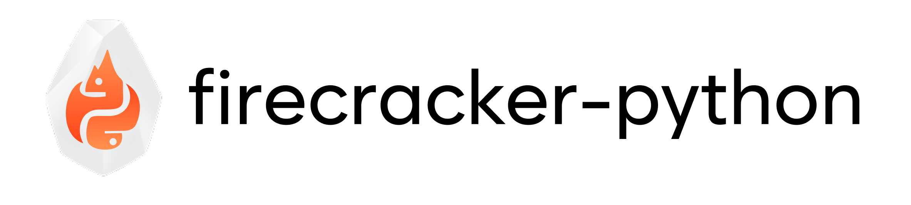

# firecracker-python

<p align="center">
<a href="https://opensource.org/license/MIT"></a>
<a href="https://github.com/hysnsec/firecracker-python"></a>
<a href="https://github.com/hysnsec/firecracker-python"></a>
<a href="https://github.com/hysnsec/firecracker-python"></a>
</p>



**firecracker-python** is a simple Python library that makes it easy to manage Firecracker microVMs. It provides a simple way to create, configure, and manage microVMs.

Some features are still being developed and will be added in the future. You can track these in the [TODO.md](TODO.md) file.

[](https://asciinema.org/a/725316)

## Table of Contents

- [How to Install](#how-to-install)
- [Key Features](#key-features)
- [Getting Started](#getting-started)
- [Usage](#usage)
- [Documentation](#documentation)
- [License](#license)
- [Contributing](#contributing)

### How to Install

Install the package from PyPI:

```bash
pip3 install hysn-firecracker-python
```

The import name is `firecracker`:

```python
from firecracker import MicroVM
```

Or install from source:

```bash
git clone https://github.com/hysnsec/firecracker-python.git
cd firecracker-python

# Using uv (recommended)
uv sync --dev

# Or using pip
python3 -m venv venv
source venv/bin/activate
pip3 install -r requirements.txt
pip3 install -e .
```

### Key Features

- Create microVMs with custom vCPU, memory and network settings
- Build a rootfs image from a Docker image
- List, pause, resume and delete microVMs
- Connect to microVMs over SSH
- Forward host ports to microVMs
- Create and load snapshots
- Pass metadata and user data through MMDS
- Attach a vsock device

### Getting Started

The easiest way to get started is to use the official Firecracker setup script:

```bash
# Download the official CI kernel and rootfs, and create an SSH key
./assets/rootfs/setup-firecracker-official.sh

# Then run the sample script
./examples/sample.py
```

The setup script creates these files:

| File | Purpose |
|---|---|
| `firecracker-files/vmlinux` | Guest kernel |
| `firecracker-files/rootfs.img` | 10 GB ext4 rootfs with SSH enabled |
| `ssh_keys/ubuntu-22.04` | SSH private key for `root` |

The official setup uses Firecracker's CI kernel and rootfs, which are **tested together**. This avoids kernel compatibility issues. See [`FIRECRACKER_SETUP.md`](FIRECRACKER_SETUP.md) for details.

To build a rootfs from your own Docker image instead, see [Build a rootfs from a Docker image](docs/rootfs.md).

#### Prerequisites

Before running the setup script, ensure you have:

- **Linux** with **KVM** enabled: `lsmod | grep kvm`
- **Firecracker binary** installed at `/usr/local/bin/firecracker`
- **Docker** installed and running. The library connects to Docker every time you create a `MicroVM` object.
- **Python 3.9+**
- **python3-nftables** installed
- **root** access. The library creates TAP devices and nftables rules.

#### Enable IP Forwarding

To enable networking for Firecracker VMs, run:

```bash
sudo sh -c "echo 1 > /proc/sys/net/ipv4/ip_forward"
sudo iptables -P FORWARD ACCEPT
```

#### Quick Start Example

```bash
# Activate virtual environment and run sample
source .venv/bin/activate
./examples/sample.py
```

The sample script:
- Picks a free subnet so the new VM does not conflict with running VMs
- Creates a VM with the files from the setup script
- Offers to open an SSH session
- Prints cleanup instructions

For a full walkthrough, read the [getting started guide](docs/getting-started.md).

### Usage

Every microVM needs a kernel (`kernel_file`) and a root filesystem (`base_rootfs`). The examples below use the files from the setup script.

#### Create a microVM with custom configuration and list them all

```python
from firecracker import MicroVM

KERNEL = "./firecracker-files/vmlinux"
ROOTFS = "./firecracker-files/rootfs.img"

# Memory accepts MiB as a number, or a string such as "4G"
vm = MicroVM(kernel_file=KERNEL, base_rootfs=ROOTFS, vcpu=2, memory="4G")
vm.create()

# List all running microVMs
for info in MicroVM.list():
    print(f"VM {info['id']} has IP {info['ip_addr']} and is {info['state']}")
```

#### Delete a microVM by id or all microVMs

```python
from firecracker import MicroVM

vm = MicroVM(kernel_file=KERNEL, base_rootfs=ROOTFS)
vm.create()

# Delete the microVM just created
vm.delete()

# Delete a specific microVM by ID
MicroVM().delete(id="<specific_id>")

# Delete all microVMs
MicroVM().delete(all=True)
```

`MicroVM()` without arguments is enough to manage VMs that already exist. You only need `kernel_file` and `base_rootfs` to create a new VM.

#### Enable port forwarding

During initialization:

```python
from firecracker import MicroVM

# Single port
vm = MicroVM(
    kernel_file=KERNEL,
    base_rootfs=ROOTFS,
    expose_ports=True,
    host_port=10222,
    dest_port=22,
)
# Multiple ports: host_port=[10222, 10280], dest_port=[22, 80]

vm.create()
```

After creation you can also expose ports using the `port_forward` function:

```python
# Forward a single port
vm.port_forward(host_port=10222, dest_port=22)
# 'Port forwarding added successfully for VMM <id>'

# Forward multiple ports
vm.port_forward(host_port=[10222, 10280], dest_port=[22, 80])

# Remove port forwarding
vm.port_forward(host_port=10222, dest_port=22, remove=True)
# 'Port forwarding removed successfully for VMM <id>'
```

> **Note:** When using port forwarding, you need to specify both `host_port` and `dest_port`. The number of host ports must match the number of destination ports. Port forwarding supports TCP only.

### Documentation

- [Getting started](docs/getting-started.md)
- [Build a rootfs from a Docker image](docs/rootfs.md)
- [API reference](docs/api-reference.md)
- [Configuration](docs/configuration.md)
- [Network](docs/network.md)
- [Snapshots](docs/snapshots.md)
- [MMDS, vsock, overlayfs and initrd](docs/advanced.md)
- [Examples](docs/examples.md)
- [Cleanup](docs/cleanup.md)
- [Testing in Docker](docs/testing-in-docker.md)

### License

This project is licensed under the MIT License. See the [LICENSE](LICENSE) file for details.

### Contributing

Contributions are welcome! Please open an issue or submit a Pull Request (PR).
